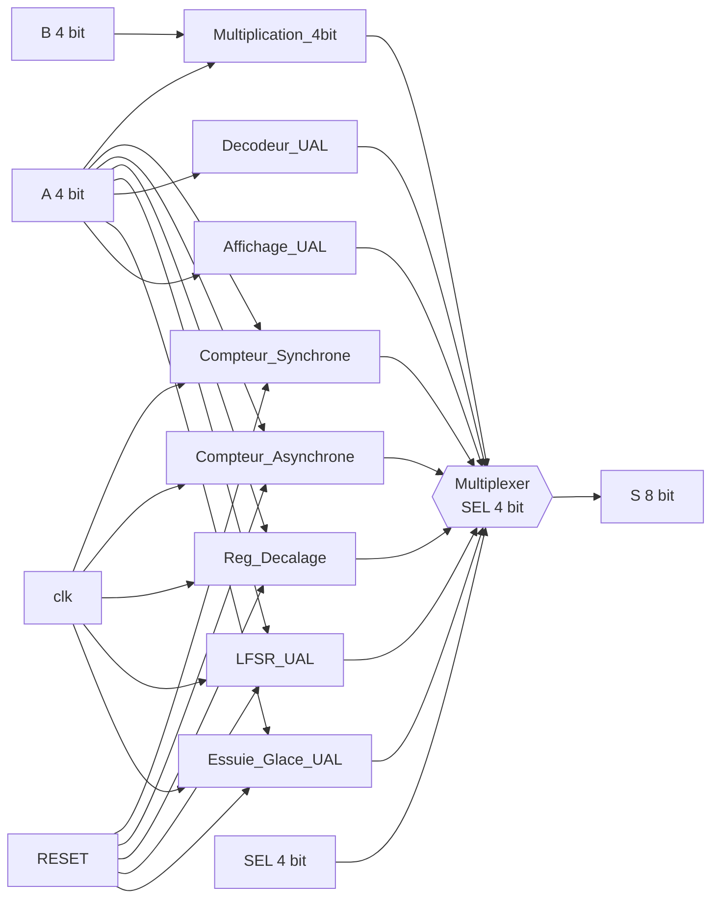
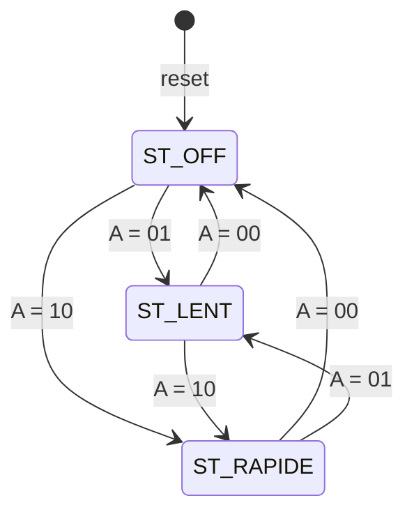

# Car Dashboard Arithmetic and Logic Unit (UAL) in VHDL

**Electronic Design Project: "Tableau de bord d'une voiture" (Group 2, Team 9)**


| | |
|---|---|
| Author | `Touati Rana` |
| Institution | `Higher School of Communication of Tunis` |
| Academic year | 2025-2026 |
| Development period | 30 January 2026 to 27 February 2026 |
| Target | Digilent Basys 3, Xilinx Artix-7 `xc7a35tcpg236-1` |

---

## Table of Contents

1. Introduction
2. System Architecture
3. Repository Structure
4. Development Environment
5. Hardware Interface and Pin Assignment
6. Build and Programming Instructions
7. Functional Description of the Modules
8. Hardware Test Procedure
9. Verification
10. Implementation Results
11. Known Limitations
12. Future Work
13. Recommended `.gitignore`
14. License

---

## 1. Introduction

### 1.1 Objective

The project implements an Arithmetic and Logic Unit (UAL, from the French *Unité Arithmétique et Logique*) in VHDL for 4-bit operands. The unit is themed as the electronics of a car dashboard: each operation of the unit corresponds to one function of a vehicle.

### 1.2 Summary of the selected operations

| No. | Operation | Role in the vehicle |
|---|---|---|
| 1 | Arithmetic multiplication | Remaining distance to travel |
| 2 | Synchronous counter with a non-linear ("random") cycle | Sensor self-test at start-up |
| 3 | Asynchronous binary counter | Engine rotation speed counting |
| 4 | Shift register (left / right) | Turn-signal light animation |
| 5 | Pseudo-random sequence register (LFSR) | Changing security code for a wireless key system |
| 6 | Decoder | Translation of the gear lever position (P, R, N, D) |
| 7 | State machine (Moore) | Wiper control (Off, Continuous, Fast) |
| 8 | 7-segment display encoding | Display of the engaged gear (P, R, N, D) |

### 1.3 Design note

The unit is a **selector-type ALU**: eight independent blocks run in parallel and a multiplexer chooses which result is routed to the output. Only the multiplier uses both operands. The other blocks use operand `A` as a control or data input and ignore `B`. Sequential blocks keep running and retain their state while another block is selected.

---

## 2. System Architecture

### 2.1 Block diagram



### 2.2 Top-level entity `UAL`

| Signal | Direction | Width | Description |
|---|---|---|---|
| `clk` | in | 1 | 100 MHz system clock |
| `RESET` | in | 1 | Reset. Asynchronous in all sequential blocks except the LFSR, where it is synchronous |
| `A` | in | 4 | Operand A / control or data input |
| `B` | in | 4 | Operand B (used by the multiplier only) |
| `SEL` | in | 4 | Selection of the active module |
| `S` | out | 8 | Result of the selected module |

### 2.3 Selection table

| `SEL` | Module | Entity | VHDL file | Type |
|---|---|---|---|---|
| `0000` | Multiplier | `Multiplication_4bit` | `Multiplication_4bit.vhd` | Combinational |
| `0001` | Synchronous counter | `Compteur_Synchrone` | `Compteur_Synchrone.vhd` | Sequential, rising edge |
| `0010` | Asynchronous counter | `Compteur_Asynchrone` | `Compteur_Asynchrone.vhd` | Sequential, ripple, falling edge |
| `0011` | Shift register | `Reg_Decalage` | `Reg_Decalage.vhd` | Sequential, rising edge |
| `0100` | LFSR | `LFSR_UAL` | `LFSR_UAL.vhd` | Sequential, rising edge |
| `0101` | Decoder | `Decodeur_UAL` | `Decodeur_UAL.vhd` | Combinational |
| `0110` | Wiper state machine | `Essuie_Glace_UAL` | `Essuie_Glace_Mealy.vhd` | Sequential, Moore FSM |
| `0111` | 7-segment encoder | `Affichage_UAL` | `Affichage_UAL.vhd` | Combinational |
| `1000` to `1111` | Unused | - | - | `S = "00000000"` |

The multiplexer is a purely combinational process sensitive to `SEL` and to all eight result signals. All sub-modules are instantiated as components in `UAL.vhd`.

### 2.4 Output word format

All modules present an 8-bit result on `S`. Narrower results are zero-extended or placed in the low bits:

| Module | Content of `S` |
|---|---|
| Multiplier | `S(7:0)` = product |
| Synchronous / asynchronous counter, shift register | `S(7:4)` = `0000`, `S(3:0)` = register value |
| LFSR | `S(7:0)` = register |
| Decoder | `S(7:4)` = `0000`, `S(3:0)` = one-hot code |
| Wiper FSM | `S(7:2)` = `000000`, `S(1:0)` = state code |
| 7-segment encoder | `S(7)` = `1` (decimal point off), `S(6:0)` = segment pattern `gfedcba`, active low |

---

## 3. Repository Structure

```
projet electronique/
|-- projet electronique.xpr                        Vivado project file
|-- Projet de conception electronique.pdf          Project specification
`-- projet electronique.srcs/
    |-- sources_1/new/
    |   |-- UAL.vhd                                Top level and SEL multiplexer
    |   |-- Multiplication_4bit.vhd
    |   |-- Compteur_Synchrone.vhd
    |   |-- Compteur_Asynchrone.vhd
    |   |-- Reg_Decalage.vhd
    |   |-- LFSR_UAL.vhd
    |   |-- Decodeur_UAL.vhd
    |   |-- Essuie_Glace_Mealy.vhd                 Contains entity Essuie_Glace_UAL (Moore FSM)
    |   `-- Affichage_UAL.vhd
    |-- constrs_1/new/
    |   `-- IO_Constraints.xdc                     Basys 3 pin and clock constraints
    `-- sim_1/new/
        `-- UAL_tb.vhd                             Self-checking testbench for the UAL entity
```

Note on naming: the file `Essuie_Glace_Mealy.vhd` contains the entity `Essuie_Glace_UAL`. The state machine is a Moore machine, as required by the specification. The file name is a legacy of the first draft.

---

## 4. Development Environment

| Item | Value |
|---|---|
| Design tool | Xilinx Vivado 2018.2 (project created with this version; newer versions can open it with an upgrade prompt) |
| Language | VHDL |
| Libraries | `IEEE.STD_LOGIC_1164`, `IEEE.NUMERIC_STD` (multiplier), `IEEE.STD_LOGIC_UNSIGNED` (synchronous counter) |
| Target device | `xc7a35tcpg236-1` (Artix-7 35T, CPG236 package, speed grade -1) |
| Board | Digilent Basys 3 |
| Top module | `UAL` |
| Clock constraint | `create_clock -name sys_clk_pin -period 10.00 -waveform {0 5}`, i.e. 100 MHz |
| I/O standard | `LVCMOS33` on all ports |

---

## 5. Hardware Interface and Pin Assignment

| Port | Basys 3 resource | FPGA pins (bit 0 to bit n) |
|---|---|---|
| `A[3:0]` | Switches SW0 to SW3 | V17, V16, W16, W17 |
| `B[3:0]` | Switches SW4 to SW7 | W15, V15, W14, W13 |
| `SEL[3:0]` | Switches SW12 to SW15 | W2, U1, T1, R2 |
| `S[7:0]` | LED0 to LED7 | U16, E19, U19, V19, W18, U15, U14, V14 |
| `RESET` | Push-button BTNC (centre) | U18 |
| `clk` | On-board 100 MHz oscillator | W5 |

---

## 6. Build and Programming Instructions

### 6.1 Prerequisites

* Xilinx Vivado 2018.2 or later (the free WebPACK edition supports the Artix-7 35T).
* A Digilent Basys 3 board connected over USB, with Digilent cable drivers installed.

### 6.2 Opening the project

1. Start Vivado and choose **Open Project**.
2. Select `projet electronique.xpr`.
3. If Vivado reports missing source paths (the project file stores paths from the original machine), create a new project instead:
   1. **Create Project**, type **RTL Project**.
   2. Add all `.vhd` files from `projet electronique.srcs/sources_1/new/` as design sources.
   3. Add `IO_Constraints.xdc` as a constraints file.
   4. Select the part `xc7a35tcpg236-1`.
4. In the Sources panel, make sure `UAL` is the top module (right-click, **Set as Top**).

### 6.3 Synthesis, implementation and bitstream

1. Flow Navigator, **Run Synthesis**.
2. Flow Navigator, **Run Implementation**.
3. Flow Navigator, **Generate Bitstream**.
4. **Open Hardware Manager**, **Open Target**, **Auto Connect**, then **Program Device** with the generated `UAL.bit`.

### 6.4 Behavioural simulation

Add `projet electronique.srcs/sim_1/new/UAL_tb.vhd` (Section 9) as a simulation source, set it as the simulation top and run **Run Behavioral Simulation**.

---

## 7. Functional Description of the Modules

### 7.1 Multiplier (`SEL = 0000`)

**Role:** calculation of the remaining distance (product of two quantities).

**Principle:** unsigned multiplication of two 4-bit operands into an 8-bit result, using `numeric_std`.

```vhdl
Res <= std_logic_vector(unsigned(A) * unsigned(B));
```

Range of the result: 0 to 225 (15 x 15).

| A | B | S | Decimal |
|---|---|---|---|
| `0011` | `0100` | `00001100` | 12 |
| `0101` | `0110` | `00011110` | 30 |
| `1111` | `1111` | `11100001` | 225 |

### 7.2 Synchronous counter with non-linear cycle (`SEL = 0001`)

**Role:** sensor self-test at start-up, stepping through a fixed pattern of states.

**Principle:** 4-bit register updated on the rising edge of `clk`. Four transitions are forced explicitly; every other state increments by one.

| Current state | Next state |
|---|---|
| `0000` (0) | `0101` (5) |
| `0101` (5) | `1010` (10) |
| `1010` (10) | `0011` (3) |
| `0011` (3) | `1111` (15) |
| any other | state + 1 |

Starting from reset (`0000`), the `others` branch is used only at `1111`, where the 4-bit increment overflows to `0000`. The effective cycle therefore contains 5 states: **0, 5, 10, 3, 15, 0, ...**

Reset is asynchronous and active high. Inputs `A` and `B` are unused.

### 7.3 Asynchronous binary counter (`SEL = 0010`)

**Role:** counting of engine revolutions.

**Principle:** 4-bit ripple counter built from four toggle flip-flops. Stage 0 toggles on the falling edge of `clk`; each following stage toggles on the falling edge of the previous stage output.

| Stage | Clock source |
|---|---|
| Q0 | falling edge of `clk` |
| Q1 | falling edge of Q0 |
| Q2 | falling edge of Q1 |
| Q3 | falling edge of Q2 |

The counter counts 0 to 15 and wraps. Reset is asynchronous and clears all stages.

| Falling edges of clk | Q3 Q2 Q1 Q0 | Value |
|---|---|---|
| 0 | 0000 | 0 |
| 1 | 0001 | 1 |
| 2 | 0010 | 2 |
| 3 | 0011 | 3 |
| 15 | 1111 | 15 |
| 16 | 0000 | 0 |

**Implementation remark:** stages 1 to 3 are clocked by internal signals. Vivado reports flip-flops of this kind as non-clocked sequential cells (methodology check `TIMING-17`). This is inherent to a ripple counter and does not affect functionality in this demonstration. Outputs of a ripple counter also change at slightly different times (propagation skew), so they are not glitch-free when sampled asynchronously.

### 7.4 Shift register (`SEL = 0011`)

**Role:** animation of the turn-signal lights.

**Principle:** 4-bit register updated on the rising edge of `clk`. The direction and serial input are taken from `A`:

| `A(0)` | Operation |
|---|---|
| `0` | Shift left; `A(1)` enters at bit 0 |
| `1` | Shift right; `A(1)` enters at bit 3 |

```vhdl
if A(0) = '0' then tmp <= tmp(2 downto 0) & A(1);
else               tmp <= A(1) & tmp(3 downto 1);
end if;
```

Example: shift left with a serial input of 1 (`A = "0010"`).

| Clock edge | Register before | Register after |
|---|---|---|
| 1 | `0000` | `0001` |
| 2 | `0001` | `0011` |
| 3 | `0011` | `0111` |
| 4 | `0111` | `1111` |

Reset is asynchronous and clears the register.

### 7.5 Linear feedback shift register (`SEL = 0100`)

**Role:** generation of a changing code for a wireless key system (demonstration of the principle).

**Principle:** 8-bit Fibonacci LFSR shifting left, with feedback `reg(7) xor reg(2)` inserted at bit 0. The register is initialised to `00000001`. Reset is **synchronous**.

```vhdl
reg <= reg(6 downto 0) & (reg(7) xor reg(2));
```

First states (hexadecimal): `01, 02, 04, 09, 12, 24, 49, 92, 25, ...`

**Sequence length:** simulated period of **217** distinct states (out of a theoretical maximum of 255). The tap pair (bit 8 and bit 3) does not correspond to a primitive polynomial. See Section 12 for a drop-in improvement.

**Security remark:** an LFSR is a pseudo-random generator, not a cryptographic one. The block illustrates the principle of a rolling code and is not suitable for real key-fob security.

### 7.6 Decoder (`SEL = 0101`)

**Role:** translation of the gear lever position into a one-hot code.

**Principle:** 2-to-4 decoder on `A(1:0)`; result on `S(3:0)`.

| `A(1:0)` | `S(3:0)` | Mode |
|---|---|---|
| `00` | `0001` | P (Park) |
| `01` | `0010` | R (Reverse) |
| `10` | `0100` | N (Neutral) |
| `11` | `1000` | D (Drive) |

The block is combinational. Only the decoding function is implemented; the 7-segment block (7.8) provides the encoding towards the display.

### 7.7 Wiper state machine (`SEL = 0110`)

**Role:** management of the wipers in three modes.

**Principle:** Moore finite state machine with two processes: a clocked state register (asynchronous reset to `ST_OFF`) and a combinational process that produces the output and the next state. The output depends only on the current state.

| State | `S(1:0)` | Mode |
|---|---|---|
| `ST_OFF` | `00` | Off |
| `ST_LENT` | `01` | Continuous (slow) |
| `ST_RAPIDE` | `10` | Fast |

The next state is determined directly by the control input `A(1:0)` from any state; the value `11` holds the current state.

| `A(1:0)` | Next state |
|---|---|
| `00` | `ST_OFF` |
| `01` | `ST_LENT` |
| `10` | `ST_RAPIDE` |
| `11` | unchanged |



Because the output is derived from the registered state, it follows a change of `A` after one rising clock edge.

### 7.8 7-segment encoder (`SEL = 0111`)

**Role:** display of the engaged gear.

**Principle:** `A(1:0)` is converted to a 7-segment pattern in the format `gfedcba`, **active low** (Basys 3 displays are common anode). Bit 7 (decimal point) is held at `1` (off).

| `A(1:0)` | `S(6:0)` | Displayed symbol | Lit segments |
|---|---|---|---|
| `00` | `0001100` | P | a, b, e, f, g |
| `01` | `0101111` | r (lowercase) | e, g |
| `10` | `0101011` | n (lowercase) | c, e, g |
| `11` | `0100001` | d (lowercase) | b, c, d, e, g |

The block is combinational.

---

## 8. Hardware Test Procedure

The procedure below applies to the sources provided in this repository, where `S` drives the eight LEDs directly (LED lit = logic `1`). Switch positions are given as SW[n] up = `1`.

### 8.1 Combinational modules (directly observable)

| Test | SEL (SW15..SW12) | Inputs | Expected LEDs |
|---|---|---|---|
| Multiplier, 3 x 4 | `0000` | A = `0011`, B = `0100` | LED3 and LED2 lit (`00001100` = 12) |
| Multiplier, 15 x 15 | `0000` | A = `1111`, B = `1111` | LED7, LED6, LED5, LED0 lit (`11100001` = 225) |
| Decoder, Park | `0101` | A = `0000` | LED0 lit |
| Decoder, Reverse | `0101` | A = `0001` | LED1 lit |
| Decoder, Neutral | `0101` | A = `0010` | LED2 lit |
| Decoder, Drive | `0101` | A = `0011` | LED3 lit |
| Unused select | `1000` to `1111` | any | all LEDs off |

SEL is read as SW15 (MSB) down to SW12 (LSB); for example `SEL = 0101` means SW15 = 0, SW14 = 1, SW13 = 0, SW12 = 1.

### 8.2 Sequential modules

At 100 MHz the registers change every 10 ns, far faster than the eye can follow, so the LEDs of sequential blocks appear dimly lit and static. Observing their sequences on the board requires a clock divider that produces a slow enable or clock (a few hertz). Their behaviour is verified in simulation (Section 9) and later project iterations added slow-clock and display circuitry (Section 10).

---

## 9. Verification

### 9.1 Self-checking testbench

The file `projet electronique.srcs/sim_1/new/UAL_tb.vhd` is a self-checking testbench for the whole `UAL` entity. It drives a 100 MHz clock and checks the output with `assert` statements.

| Block | Checked behaviour |
|---|---|
| Multiplier | 3 x 4 = 12, 15 x 15 = 225 |
| Decoder | all four one-hot codes |
| 7-segment encoder | all four patterns (P, r, n, d) with bit 7 = `1` |
| Unused `SEL` | output equals `00000000` |
| Synchronous counter | sequence 0, 5, 10, 3, 15, wrap to 0 after reset |
| Shift register | four left shifts with serial input 1 |
| Wiper FSM | OFF, LENT, RAPIDE and return to OFF |
| LFSR | seed `01` followed by `02`, `04`, `09` |

The testbench was compiled and run against the sources of this repository with GHDL 4.1 (VHDL-2008, `-fsynopsys` required because of `std_logic_unsigned`) and completes with no assertion failure. The asynchronous (ripple) counter is not covered.

### 9.2 Running with GHDL

Run the commands from the root of the repository:

```bash
S="projet electronique.srcs/sources_1/new"

ghdl -a --std=08 -frelaxed -fsynopsys \
     "$S"/Multiplication_4bit.vhd "$S"/Compteur_Synchrone.vhd "$S"/Compteur_Asynchrone.vhd \
     "$S"/Reg_Decalage.vhd "$S"/LFSR_UAL.vhd "$S"/Decodeur_UAL.vhd \
     "$S"/Essuie_Glace_Mealy.vhd "$S"/Affichage_UAL.vhd "$S"/UAL.vhd \
     "projet electronique.srcs/sim_1/new/UAL_tb.vhd"

ghdl -e --std=08 -frelaxed -fsynopsys UAL_tb
ghdl -r --std=08 -frelaxed -fsynopsys UAL_tb
```

A successful run prints `Testbench finished` and no `FAIL` message. To also record a waveform, append `--wave=ual.ghw` to the last command.

In Vivado, add `UAL_tb.vhd` under **Simulation Sources** and run the behavioural simulation.

---

## 10. Implementation Results

All runs target `xc7a35tcpg236-1` with a 100 MHz clock constraint, Vivado 2018.2. For all three runs the tool reports that all user-specified timing constraints are met.

### 10.1 Resource and timing summary per iteration

| Iteration | Description | Slice LUTs | Slice registers | I/O used | WNS (setup) | WHS (hold) |
|---|---|---|---|---|---|---|
| 1 | Sources in this repository, `S` on the LEDs | 46 (0.22 %) | 23 (0.06 %) | 22 | +8.394 ns | +0.143 ns |
| 2 | Display outputs added | 81 (0.39 %) | 51 (0.12 %) | 34 | +5.624 ns | +0.287 ns |
| 3 | Final, all functions on the 7-segment display | 169 (0.81 %) | 97 (0.23 %) | 34 | +5.424 ns | +0.276 ns |

Available resources on the device: 20,800 slice LUTs, 41,600 slice registers, 106 bonded IOBs.

WNS: worst negative slack (setup). WHS: worst hold slack. Positive values mean the constraint is met.

### 10.2 Power (iteration 3)

| Quantity | Value |
|---|---|
| Total on-chip power | 0.088 W |
| Dynamic power | 0.017 W |
| Device static power | 0.072 W |
| Junction temperature | 25.4 degrees C |
| Confidence level | Low (default switching activity) |

### 10.3 Tool messages (iteration 3)

| Message | Count | Explanation |
|---|---|---|
| Critical warnings | 0 | - |
| Errors | 0 | - |
| `TIMING-17` Non-clocked sequential cell | 21 | Flip-flops driven by derived or divided clock signals that are not defined as clocks |
| `TIMING-18` Missing input or output delay | 21 | No I/O delay constraints; not relevant for a switches-and-LEDs demonstration |
| `CFGBVS-1` | 1 | `CFGBVS` and `CONFIG_VOLTAGE` properties not set |
| `Synth 8-614` | 1 | A signal read in a process but missing from its sensitivity list in the display multiplexing code |

### 10.4 Note on the iterations

Iteration 1 corresponds to the sources provided in this repository. Iterations 2 and 3 added display and LED outputs, a slow clock, and display multiplexing so that the sequential blocks can be observed on the board; the corresponding top-level source and constraint file are not part of this snapshot.

---

## 11. Known Limitations

1. **LFSR period.** The implemented feedback polynomial gives 217 states instead of 255.
2. **Observability of sequential blocks.** In the delivered sources all sequential modules are clocked directly at 100 MHz (Section 8.2).
3. **Ripple counter.** Derived clocks are not timed by the tool (`TIMING-17`) and outputs are not synchronous with each other.
4. **Reset.** The reset is not synchronised or debounced, and its style is mixed (asynchronous in most blocks, synchronous in the LFSR).
5. **Unused operands.** Operand `B` is used only by the multiplier, and several modules ignore the upper bits of `A`.
6. **Decoder / encoder.** Only the decoding function is implemented.
7. **Naming.** The wiper FSM file is named `Essuie_Glace_Mealy.vhd` although it implements a Moore machine.
8. **Verification scope.** The ripple counter has no automated test.

---

## 12. Future Work

1. **LFSR with maximal length.** Replace the feedback by the four-tap form, which was verified to cycle through all 255 non-zero states:

   ```vhdl
   reg <= reg(6 downto 0) & (reg(7) xor reg(5) xor reg(4) xor reg(3));
   ```

2. Add a clock-enable divider and a button debouncer to the top level so that every block can be observed on the board.
3. Synchronise the reset signal with a two-stage synchroniser and use a uniform reset style.
4. Rename `Essuie_Glace_Mealy.vhd` and its entity to a Moore-based name.
5. Add a dedicated encoder block, or document the 7-segment block as the encoding stage.
6. Extend the testbench to cover the ripple counter and reset behaviour of each block.
7. Provide a Tcl script that recreates the Vivado project with relative paths.

---

## 13. Recommended `.gitignore`

```gitignore
# Vivado generated files
*.jou
*.log
*.str
*.dcp
*.bit
*.ltx
hs_err_pid*
.Xil/
*.cache/
*.runs/
*.hw/
*.sim/
*.ip_user_files/

# Simulation
*.wdb
*.wcfg
*.ghw
```

The project file `*.xpr` should remain tracked (or be replaced by a project-recreation Tcl script) so that the project can be reopened.

---

## 14. License

Specify the license of the repository here (for example MIT) and retain the author and institution information at the top of this document.
